# Foldback: User Manual

Headphone (cue) mixes for REAPER · Nov 9, 2026

**Contents**

- [What Foldback is](#what-foldback-is)

- [Before you start](#before-you-start)

- [Installing with ReaPack](#installing-with-reapack)

- [The panel](#the-panel)

- [First-time setup](#first-time-setup)

- [Stems mode](#stems-mode)

- [Mixes mode](#mixes-mode)

- [Listen, Talkback, Click and Metronome](#listen-talkback-click-and-metronome)

- [Moving on to mixing](#moving-on-to-mixing)

- [Settings reference](#settings-reference)

- [Troubleshooting](#troubleshooting)

## What Foldback is

Foldback is a free REAPER script that builds and manages headphone cue mixes for the artists you are recording. It creates the cue tracks, wires up the sends and hardware outputs, and gives you one panel to control it all while you track.

It has two cue modes to select from:

- **Stems.** You build a small set of shared groups (for example Drums, Guitars, Bass, Vocals) and send each performer the same groups. This is useful for when the artist has a personal mixer that allows them to control levels for themselves individually. A Metronome row is also available; it only reserves an output for the metronome.

- **Mixes.** You build one stereo mix per performer (Artist 1 to Artist 4 by default), and every track can be sent to each mix at its own level. A **Start from my mix** option begins each cue mix from your current project mix. New tracks have a silent send added to them, so nothing unexpected reaches anyone's headphones.

On top of the cue mixes, Foldback provides:

- **Listen**, to audition any cue in your own monitors.

- **Talkback**, a hold-to-talk button that sends your microphone to the performers.

- **A click track** (mix mode) or REAPER's own metronome (stems mode).

- **A safety limiter** on every cue, to protect performers' hearing.

- **Profiles**, so each studio or setup keeps its own settings.

Foldback is free software released under the GPL-3.0 license.

## Before you start

You need:

- **REAPER** (a current version).

- **ReaPack**, the REAPER package manager. Foldback is installed and updated through it.

- **ReaImGui**, a library that draws Foldback's windows. It is required, and ReaPack does not install it automatically, so you add it yourself (see the next section).

- **Optional:** the SWS extension and js_ReaScriptAPI. Foldback works without them, but some conveniences depend on them being present.

- An audio interface with enough spare hardware outputs to feed your headphone amplifiers or cue boxes. Each cue (stem or mix) is sent to its own hardware output, stereo or mono.

- For talkback: a microphone connected to an input of your interface.

Foldback is not tied to any particular interface. You choose each cue's output from a list of the outputs REAPER reports for your device.

## Installing with ReaPack

**1. Add the Foldback repository.**

1.  In REAPER, choose **Extensions \> ReaPack \> Import repositories**.

2.  Paste the Foldback repository address (<https://github.com/GSS-Reaper/foldback/raw/main/Foldback-ReaPack/index.xml>) and click **OK**.

3.  Accept the prompt to add the repository.

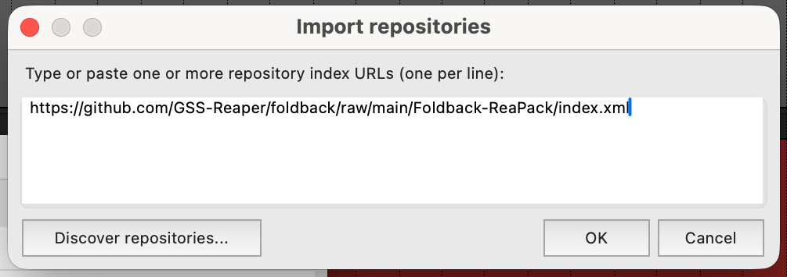

**2. Install Foldback.**

1.  Choose **Extensions \> ReaPack \> Browse packages**.

2.  Type foldback in the filter box.

3.  Right-click the Foldback entry and choose Install, then click OK / Apply.

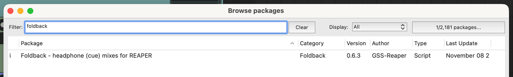

**3. Install ReaImGui.**

1.  In **Browse packages**, search for ReaImGui.

2.  Right-click it, choose Install, and apply.

3.  Restart REAPER if it asks you to.

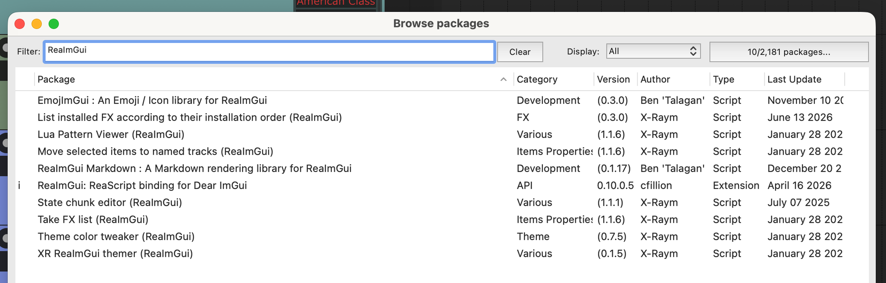

**4. Find the actions.**

Open the Actions list (press ? or use **Actions \> Show action list**) and type foldback in the filter. The Foldback actions appear.

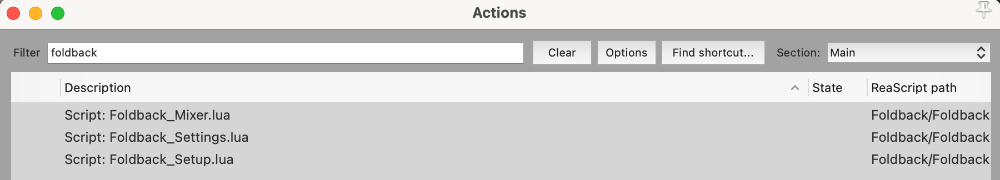

**Updating.** Use **Extensions \> ReaPack \> Synchronize packages**. When a new version is published it is offered there; if Browse packages still shows an older version number, synchronize again.

## The panel

Start the Foldback panel from the Actions list. Until a session has been set up, the panel is empty and offers a **Settings** button and a message that no cues exist yet.

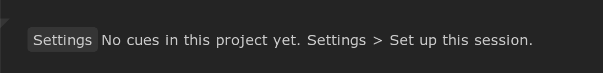

See [First-Time Setup](#first-time-setup) below for instructions on how to set up your cues for the first time.

Once cues exist, the panel is split in two:

- **Left: the cues.** One column per cue, in the cue's color, with the cue's name at the top. Each column holds the cue's overall level fader, an output label, and its **Listen** button. Down the left edge, a label column holds the **Settings** button and the **Talkback** button. Click on the cue name to bring up a pop-up that allows you to view and adjust all tracks sending to that cue.

- **Right: Selected tracks.** Select one or more tracks in REAPER and their sends into each cue appear here, lined up under the cue columns. Select nothing and the section simply says to select tracks. With several tracks selected, an All selected row appears that moves all of their sends together.

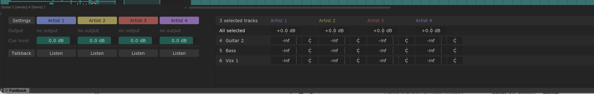

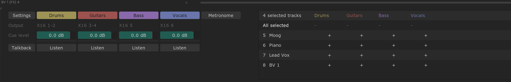

**Level boxes.** Faders in Foldback are drag boxes. Drag to change the level; double-click to return to the default (0 dB for sends and cue levels). Shift-click a send to mute or unmute it. Right-click a send for a menu with **Set to 0 dB** and **Remove send**. A dash or plus where a send would be means there is no send yet; click it to add one.

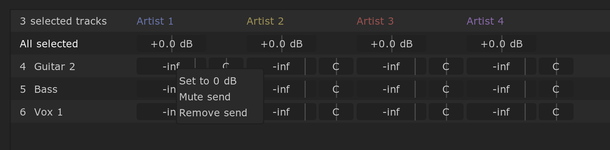

**Docking.** The **Settings** pop-up has **Dock in REAPER docker** and **Float** buttons, so the panel can live in a REAPER docker or float as its own window.

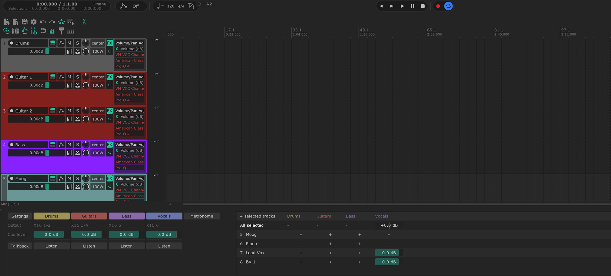

**Profile.** The **Settings** pop-up also shows which profile is in use, with buttons to open the profile file, open the logs folder, and reload the profile.

## First-time setup

Setup happens in two steps: First, you describe your cues in **Settings**, then you build them in the current project with **Set up this session**.

**1. Choose a profile.** A profile holds all of Foldback's settings for one studio or setup. Foldback ships with two neutral starting profiles: **Starter Mixes** (mix mode, one mix per performer) and **Starter Stems** (stem mode). Pick the one that matches how you work. You can make your own with New, Duplicate, Rename and Delete in the Settings window.

**2. Open Settings and go to the Cues tab.** Here each cue has a name, a type (stereo or mono), and a hardware output. Set each cue's output to the interface output that feeds that performer's headphones. Two cues cannot share the same output; Foldback will tell you if they conflict. In mix mode a button replaces the list with Artist 1 to Artist 4; in stems mode a button replaces it with Drums, Guitars, Bass and Vocals. Rename any cue to suit your session, and add or delete additional cues as needed.

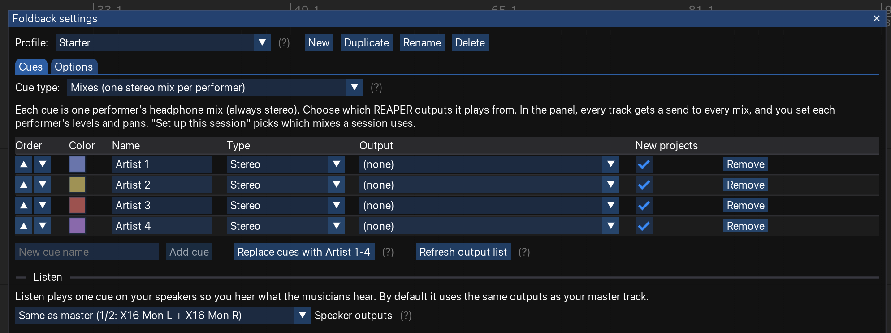

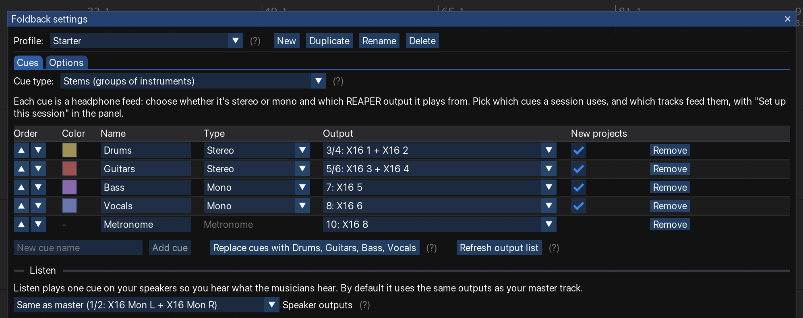

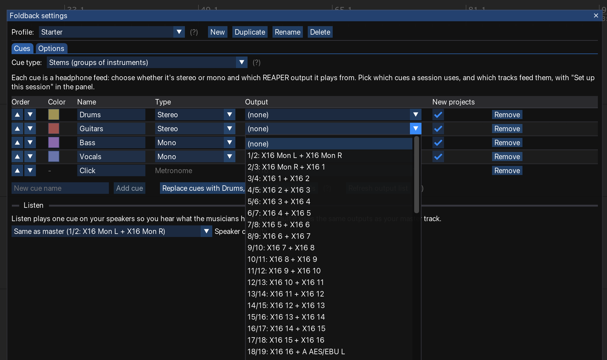

**3. Use the Options tab** to set the options you care about (see the Settings discussion below), especially the send mode, the safety limiter and, if you want it, talkback. Click **Save**.

**4. Run Set up this session.** From the panel's **Settings** pop-up choose **Set up this session** (cues and tracks)... The setup window opens:

- **Section 1 lists your cues** with a tick box each. Untick any you do not need in this project. Cues you remove are listed in orange along with the note that their sends will be removed.

- **Section 2 is a grid of your tracks against the cues.** Tick a box to send that track to that cue. All and None buttons fill a whole column. Untick any you do not want.

- The footer shows the send mode and starting level that new sends will use.

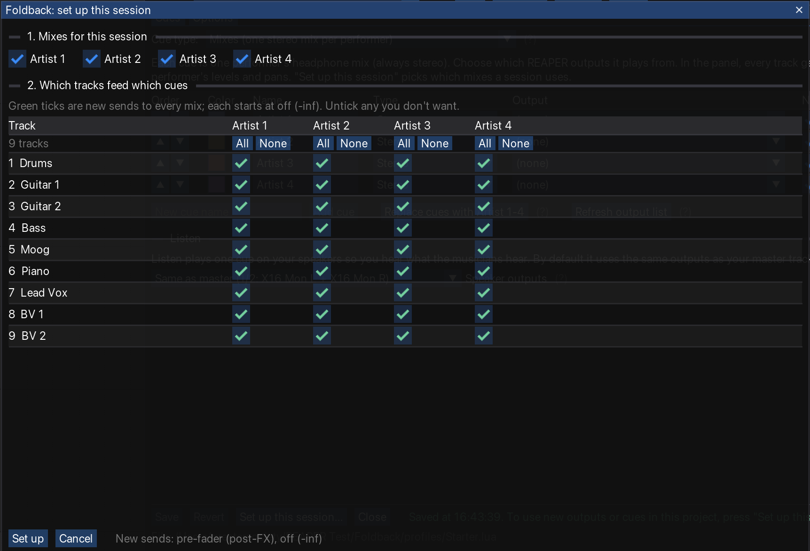

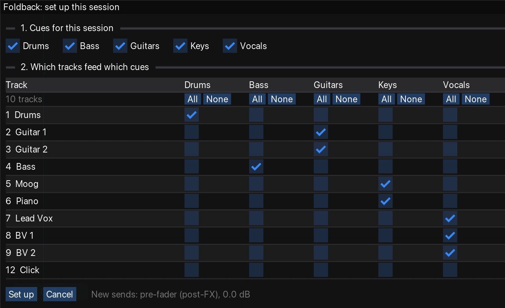

Click **Set up**. Foldback creates the hidden cue tracks, the sends, and (if enabled) the CUE LISTEN, TALKBACK and Click tracks, and assigns hardware outputs. A conflict message in red disables the button until it is fixed.

**Running it again.** **Set up this session** is safe to run again after you add tracks or change cues. Sends you made by hand are left alone unless you have turned on the option to reset existing sends to the chosen send mode.

## Stems mode

In stems mode each cue is a shared group. Every performer who is given a group hears it at the level you set, so one cue fader changes what everyone on that output hears.

**Defining the cues.** In **Settings \> Cues**, use the **Starter Stems** profile or click the button that replaces the list with Drums, Guitars, Bass and Vocals (Drums and Guitars stereo; Bass and Vocals mono). Rename, add or remove rows as needed, and choose each row's output from its drop-down. A Metronome row can be kept in the list; it does not create a cue, it only reserves an output so nothing else is assigned to it.

**Getting tracks into the groups.** In **Set up this session**, tick the stems each track should feed in the grid. After that, you can add or remove a send at any time from the Selected tracks section: select the track, then click the plus under the cue, or right-click an existing send and choose **Remove send**. A track you add to the project later has no sends until you add them this way.

**Balancing a stem.** Select the tracks that feed a stem and drag a send to change that track's level inside the stem. The cue's own level box (at the top of its column) sets the overall stem level on the output. Double-click a level box to return it to 0 dB; shift-click to mute or unmute it.

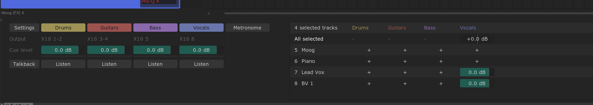

**Moving several tracks together.** With several tracks selected, the All selected row moves every selected track's send into that cue by the same amount. Double-click sets them all to 0 dB; Shift-click mutes or unmutes them.

**The Metronome column.** If your profile has a Metronome row, the panel shows an extra column with a single button carrying that row's name. Click it to open REAPER's own metronome settings. Foldback does not change the metronome itself: you point REAPER's metronome output at the output reserved for the row. Because the REAPER metronome goes straight to hardware, it cannot be heard through Listen.

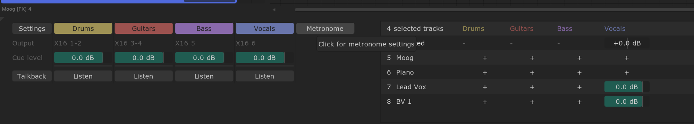

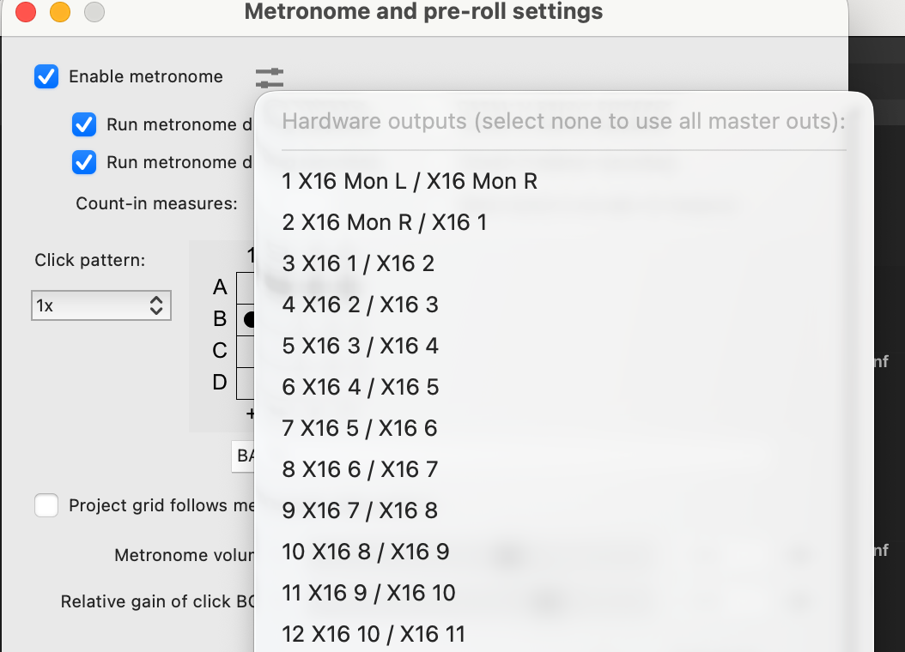

**Pan.** Per-send pan boxes are part of mixes mode.

## Mixes mode

In mixes mode each cue is a complete stereo mix for one performer. By default there are four: Artist 1 to Artist 4. Rename them as needed, or add more mixes, in **Settings \> Cues**.

**Every track can reach every mix.** In the Selected tracks section, each selected track has a level box and a pan box under every mix. Drag a level to set how loud that track is in that performer's headphones; drag a pan box to place it (L100 to R100, C in the center; hold Alt for fine control; double-click returns to center).

**New tracks start silent.** With the default option **New mix sends start off (silent)**, a track added to the project gets a send to every mix, but those sends are off. Nothing reaches anyone's headphones until you raise it. Two Options control this: **New tracks get** (**A send to every mix**, or **No sends until I add them**) and the starting level, if you turn the silent option off.

**Starting from your own mix.** At the bottom of a mix's pop-up is a **Start from my mix** button. It makes a one-time copy of each track's fader level, pan and mute into that mix, as a starting point for that performer. It replaces what is in the mix at that moment, so use it before you fine-tune, not after.

**Cue pop-up.** Click a cue's name at the top of its column to open its pop-up, showing that cue's name and output, the **Start from my mix** button, and **Tick all** / **Tick none** for moving tracks together.

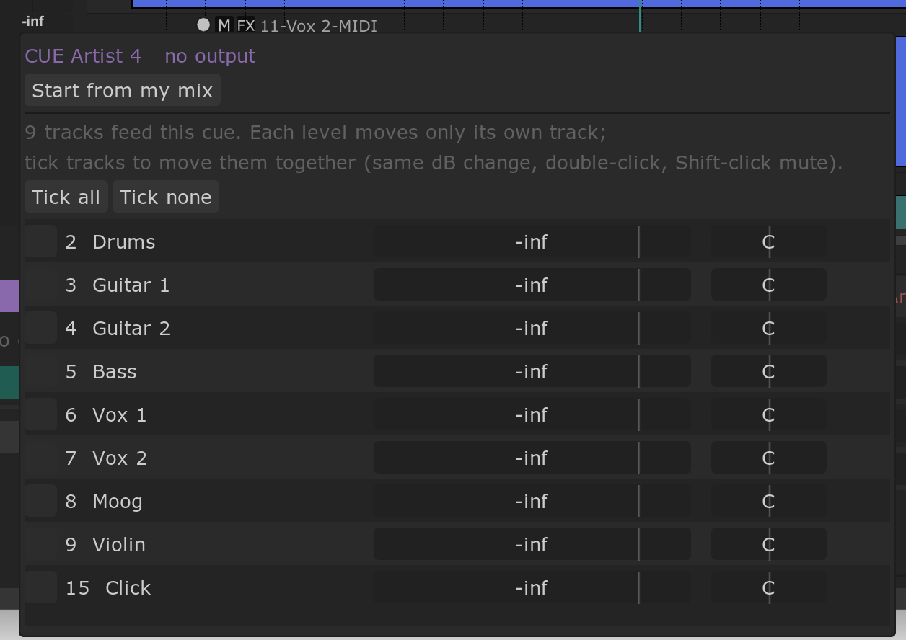

**Working across tracks.** Tick tracks in the pop-up (**Tick all** / **Tick none**) to move them together: the same dB change, a double-click to reset, or Shift-click to mute together.

**The Click track.** In mix mode, Foldback can add a track named Click that sounds on every beat of the project's tempo and time signature and follows tempo changes. It gets its own send to every mix, off at first, so each performer sets their own click level and pan. Turn it on with **Add a click track that feeds every mix** in **Settings \> Options**, save the profile, and run **Set up this session**. It does not use REAPER's metronome settings.

## Listen, Talkback, Click and Metronome

### Listen

Listen lets you hear a single cue on your own monitors, exactly as the performer hears it.

1.  Click the **Listen** button under a cue. It turns red and reads LISTENING.

2.  Your monitors now play that cue, and the normal master output is muted while you listen.

3.  Click the button again to go back to your own mix.

4.  To hear several cues together, Shift-click additional **Listen** buttons.

Listen uses a hidden track called CUE LISTEN. By default it plays on the same output pair as your master track; to use a different pair, change **Speaker outputs** in the **Listen** section of **Settings \> Cues**. If a project was made before a Listen output was chosen, Foldback adds the Listen track the first time you press the button.

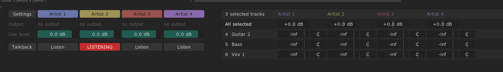

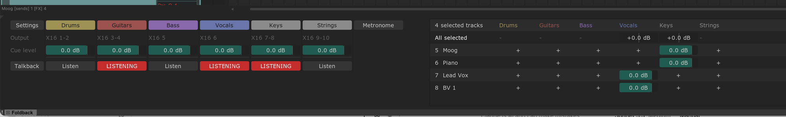

### Talkback

Talkback lets you speak into every performer's headphones.

1.  In **Settings \> Options**, tick **Add a talkback button** and choose your microphone's input (Microphone input) from the drop-down. The microphone is used as a mono input.

2.  **Save**, and run **Set up this session** so the TALKBACK track exists.

3.  In the panel, press and hold the **Talkback** button with the mouse. It turns red while held. Speak, then let go; the cues close again at once.

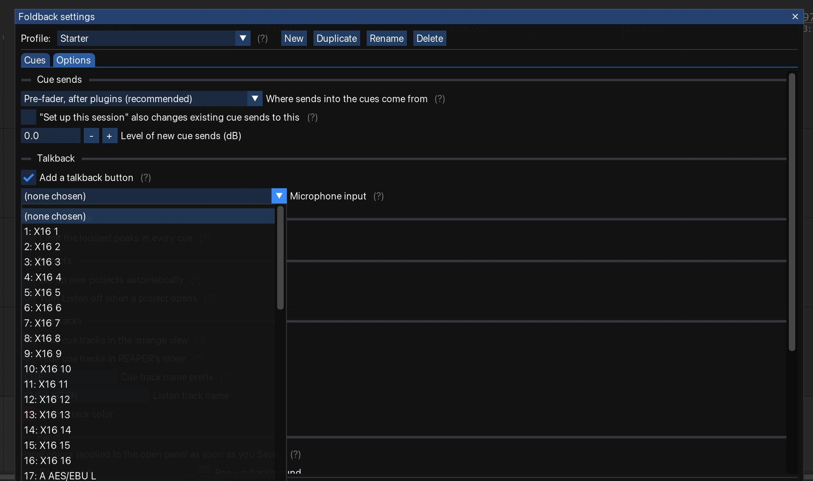

Foldback applies the chosen input to the TALKBACK track every time you press the button, so changing the input in **Settings** takes effect immediately. If no input is chosen or found, the button's tooltip tells you. To test without a performer, hold the button with the transport stopped and watch the thin meter bars under each cue move.

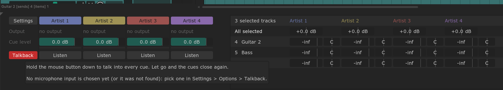

### Click track (mixes mode)

The Click track is described under Mixes mode. In short: tick **Add a click track that feeds every mix**, save, run **Set up this session**, and each performer gets their own click level and pan.

### Metronome (stems mode)

In stems mode there is no Foldback click. The Metronome row only reserves an output, and its panel button opens REAPER's metronome settings. In those settings, send the metronome to the reserved output. Listen cannot play the metronome because REAPER sends it directly to hardware.

## Moving on to mixing

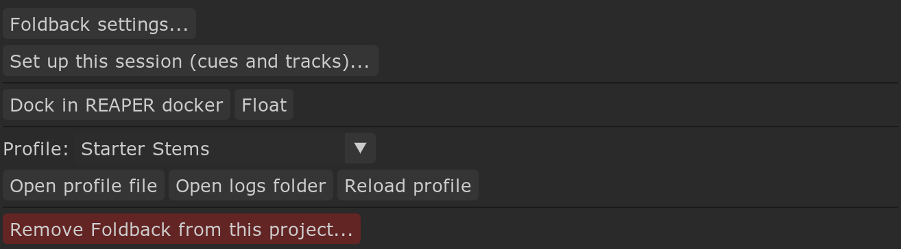

When tracking is done, **Remove Foldback from this project...** takes every cue send and every Foldback track out of the project in one step, so your mix session starts clean.

1.  Click **Settings** in the panel.

2.  Click the red **Remove Foldback from this project...** button at the bottom of the pop-up. It is greyed out when the project has nothing from Foldback.

3.  A window lists what will go: the number of cue tracks, the other Foldback tracks by name (CUE LISTEN, TALKBACK, Click) and the number of cue sends on your tracks.

4.  Click **Remove**, or **Cancel** (or press Esc) to leave everything as it is.

**What is removed:** every cue track, CUE LISTEN, TALKBACK, the Click track, every send from your tracks into those tracks, and Foldback's hidden notes on your tracks. If Listen or Talkback is on, it is switched off first, so your master's mute goes back to how you had it.

**What is left alone:** your own tracks, their other sends (reverb and effect buses, for example), faders, pans, plug-ins, names and folders, and REAPER's metronome settings.

**Undo.** The whole removal is one undo step. **Edit \> Undo** brings everything back, and the panel shows your cues again.

**Afterwards.** Foldback stays off in that project: new tracks get no cue sends. The panel says what was removed and shows a **Set up Foldback in this project...** button in case you go back to tracking. Other projects are not affected.

## Settings reference

Open **Settings** from the **Settings** button in the panel. The window has a profile selector at the top (with New, Duplicate, Rename and Delete) and two tabs below: **Cues** and **Options**. At the bottom are **Save**, **Revert**, **Set up this session**... and **Close**. Changes apply when you save; if you close with unsaved changes, Foldback asks whether to save them.

### Cues tab

- **Cue type.** Stems (groups of instruments) or Mixes (one stereo mix per performer). Switching to mixes makes every cue stereo.

- **The cue list.** One row per cue: name, type (stereo or mono), output, color, and a **Remove** button. **Add cue** adds a row. Outputs come from the list REAPER reports for your interface; **Refresh output list** re-reads it after you change interface settings.

- **Replace cues with...** buttons. Artist 1-4 in mixes mode; Drums, Guitars, Bass, Vocals in stems mode. **Revert** undoes the replacement.

- **Listen.** **Speaker outputs**: by default the same pair as your master track.

### Options tab

- **Cue sends.** Where sends into the cues come from: pre-fader (post-FX) is the default, so your faders, mutes and solos never change what performers hear. A checkbox decides whether **Set up this session** also resets existing cue sends to this mode. In mixes mode: **New mix sends start off (silent)**; **New tracks get**; and **Add a click track that feeds every mix**.

- **Talkback.** **Add a talkback button**, and **Microphone input**.

- **Safety limiter.** **Limit the loudest peaks in every cue** puts a limiter last on each cue track so a sudden peak (feedback, a bad fader move) cannot exceed the ceiling. The default **Ceiling** is -3 dB; lower is quieter and safer. It is not a compressor and does nothing to normal levels.

- **Projects.** **Set up new projects automatically**, and **Turn Listen off when a project opens** (so a project saved while listening does not open with your speakers muted).

- **Cue tracks.** **Hide cue tracks in the arrange view** and in REAPER's mixer (they still work), a **Cue track name prefix** (default style: CUE Drums) and the Listen track's name and color. Hiding takes effect the next time you run **Set up this session**.

- **Panel.** Panel colors for the background, buttons, level boxes, meters and the lit Listen button. They affect only Foldback's panel, not your REAPER theme or track colors. Reset buttons restore the defaults.

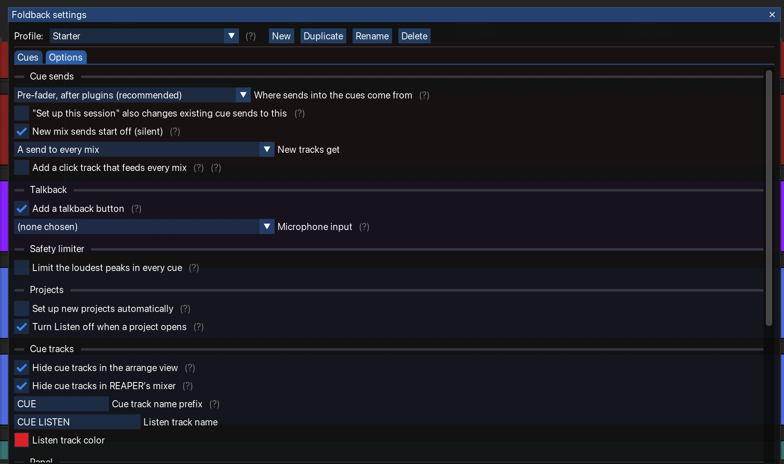

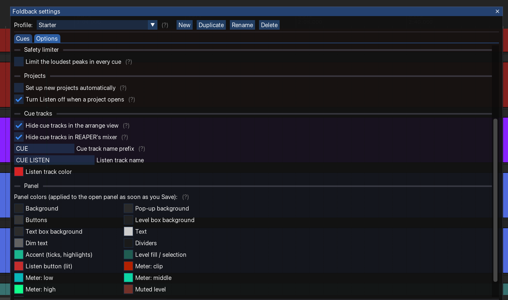

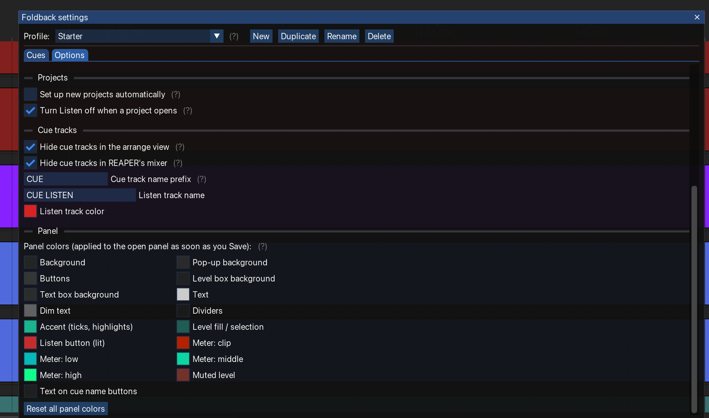

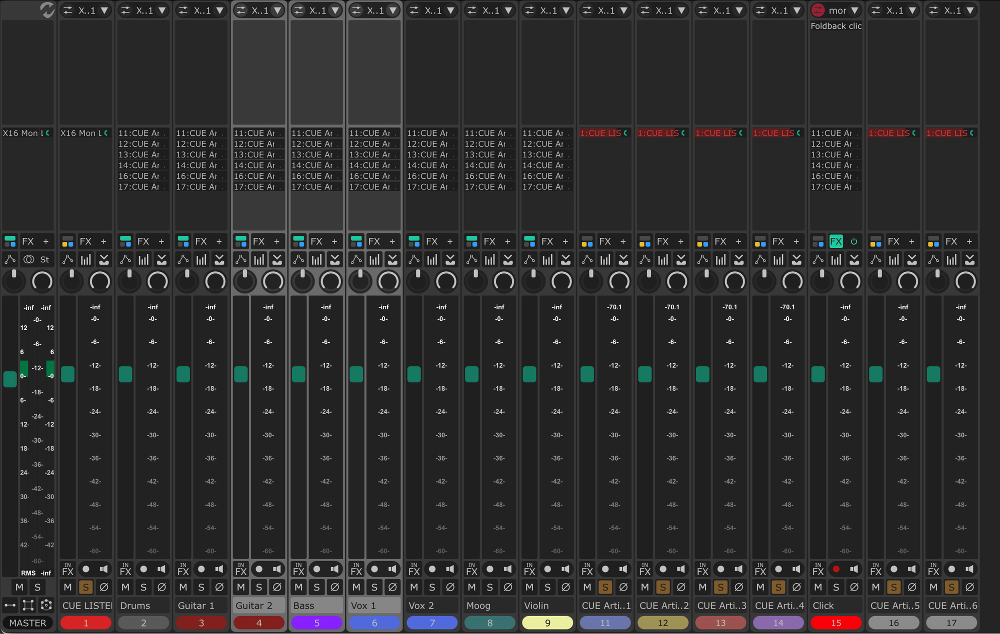

## Troubleshooting

### Troubleshooting

- **The Foldback actions do nothing or the panel will not open.** Check that ReaImGui is installed (**Extensions \> ReaPack \> Browse packages**) and restart REAPER.

- **The panel says there are no cues.** Open **Settings** and run **Set up this session**.

- **A performer hears nothing.** Check, in order: the cue's output in **Settings \> Cues**; that the track actually has a send to that cue (a plus means no send yet); that the send is not muted; in mixes mode, that the send was raised, because new mix sends start silent; and that the cue's own level box is not turned down.

- **Two cues refuse to set up.** The setup window shows a red message when two cues share an output. Give each cue its own output.

- **Talkback is silent.** Make sure **Add a talkback button** is ticked, a **Microphone input** is chosen, and the profile is saved. Hover the **Talkback** button; its tooltip says when no input is chosen or found. Hold the button and watch the thin meter bars under the cues to confirm signal.

- **Browse packages shows an older version.** **Synchronize packages** again after the new version has been published.

- **Your speakers are silent after opening a project.** The project was saved while Listen was on. Click **LISTENING** to turn it off, and leave **Turn Listen off when a project opens** ticked.

- **The metronome settings do not open when you click the Metronome button.** Click it again; Foldback opens the REAPER settings a moment after the click.

- **Cue tracks are missing from the track list.** They are hidden by default. Untick **Hide cue tracks in the arrange view** or in REAPER's mixer, then run **Set up this session** again.

- **Logs.** The **Settings** pop-up has an **Open logs folder** button, useful when reporting a problem.

### License

Foldback is free software, released under the GNU General Public License, version 3 (GPL-3.0). Copyright Greater Society Studios.
